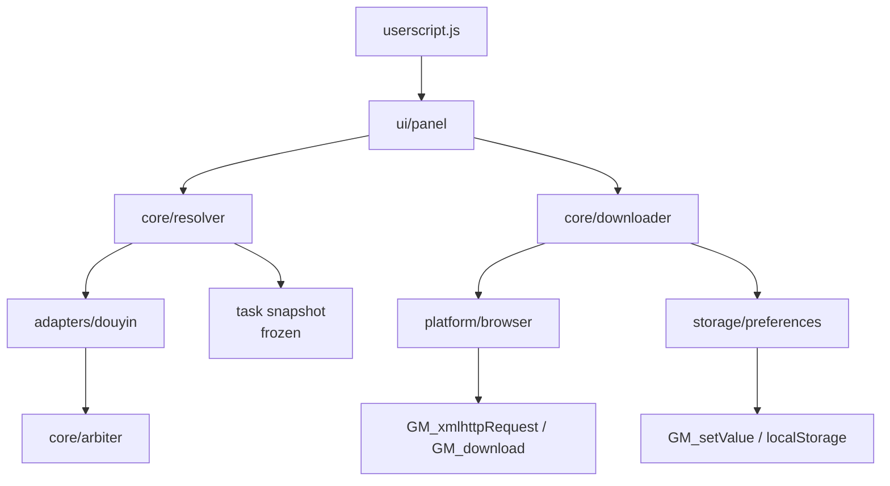

# 架构

## 一次下载的完整时序

1. 用户点 ⬇ → `ui.openPanel()`
2. `adapter.resolveCurrent()` 采集候选：
   - `urlIds()`：`/video/{id}`、`?modal_id=`、`?vid=`
   - `[data-e2e="feed-active-video"]`（需可见）
   - `dialogScope()` 内正在播放的播放器
   - 无 URL 标识时，只接受「正在播放 + 30% 可见」的播放器
   - `lastClick`（同路由、30 秒内）
3. `core/arbiter.decide(candidates)`：
   - 单 ID → 直接采用
   - 多 ID → 有 URL/浮层权威来源则采纳并记 `dom-disagrees`；否则 `conflict` 拒绝
4. `core/resolver.snapshot()` 冻结 `{awemeId, via, title, pageUrl}`
5. 用户点「开始下载」→ `downloader.start(task)`
6. `parse()` → 校验返回 `id === awemeId`（不一致立即中止）
7. 需要时按 `quality_list` 二次解析升到最高档
8. `buildJob()` 按勾选组装；逐项 `saveBlob()`
9. 文案走 Blob 下载；结束打印 `DONE files=N`

## 为什么不合并模块

- `arbiter` 必须是纯函数，否则无法在 node 里回归测试串号规则
- `adapter` 是唯一会随抖音改版失效的层，隔离后改动面最小
- `platform` 是唯一区分管理器 API 的地方，便于以后适配其他管理器
